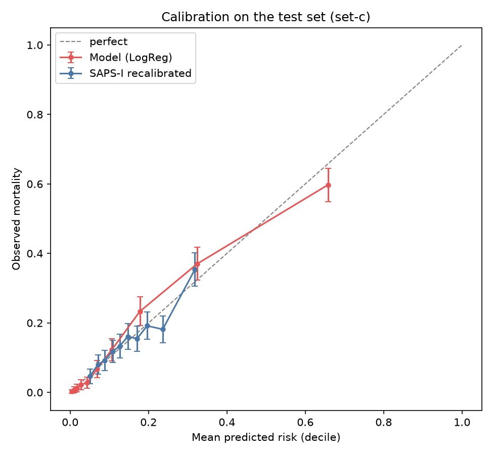
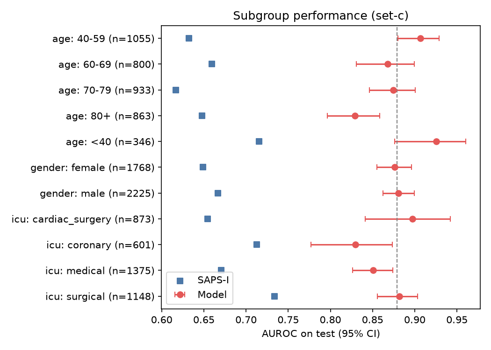
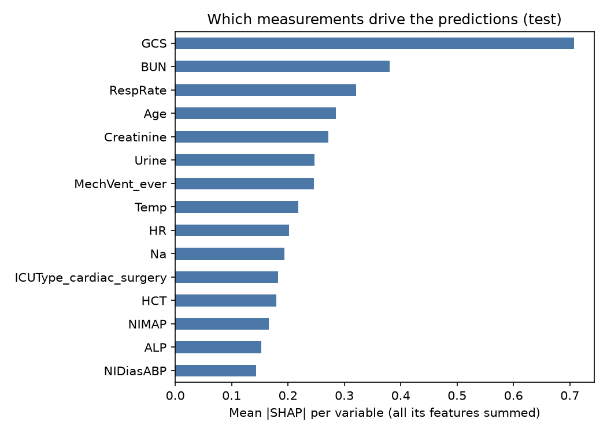

# ICU In-Hospital Mortality Prediction

**Predicting in-hospital death from the first 48 hours of an ICU stay. On a held-out test set, a regularised logistic regression reaches AUROC 0.879, against 0.658 for the SAPS-I severity score.**

Data: PhysioNet/CinC Challenge 2012 (12,000 ICU stays). Python, pandas, scikit-learn, LightGBM, SHAP, Streamlit.

## Results (test set = set-c, 3,997 stays, 585 deaths, scored once)

| | AUROC [95% CI] | AUPRC [95% CI] |
|---|---|---|
| **Model (logistic regression)** | **0.879** [0.864, 0.892] | **0.564** [0.523, 0.606] |
| SAPS-I (clinical score) | 0.658 [0.634, 0.679] | 0.251 [0.221, 0.284] |
| SOFA (clinical score) | 0.636 [0.614, 0.659] | 0.254 [0.227, 0.287] |

- **Gain over SAPS-I** on the same 3,834 patients (paired bootstrap): +0.22 AUROC [+0.20, +0.24], +0.31 AUPRC [+0.27, +0.35]. A random model's AUPRC is 0.146.
- **No overfitting:** cross-validated AUROC on the development set was 0.867.
- **Calibration:** mean predicted risk 14.4% vs 14.6% observed. Calibration slope 0.95, Brier score 0.089.
- **At the alert threshold** (frozen on the development set to catch 80% of deaths): sensitivity 81%, specificity 80%, PPV 41%, 29% of stays flagged. SAPS-I needs to flag 68% of stays for similar sensitivity.
- **Subgroups:** AUROC 0.83 to 0.93 across age bands, gender and ICU types. Lowest for age 80+ and coronary care. The model beats SAPS-I in every subgroup.

| Calibration (test) | Subgroups (test) | What drives predictions (SHAP) |
|---|---|---|
|  |  |  |

## Approach

1. **Features** (`notebooks/02_wrangling.ipynb`, `src/features.py`). The irregular time series becomes one row per stay: min, max, mean, last value, number of measurements and a measured/not-measured flag for 36 variables, plus age, gender, height, weight, ventilation and ICU type (225 features). Only physically impossible values are removed (0.16%). Missingness is kept as signal: stays where lactate was measured have twice the mortality.
2. **Split.** Set-a + set-b for development (5 stratified folds), set-c held out as the test set. 13 stays with no measurements at all were excluded (all survivors).
3. **Modeling** (`notebooks/04_modeling.ipynb`, `src/models.py`). Logistic regression, random forest and LightGBM, tuned with **nested cross-validation**. Imputation, log transforms and scaling sit inside a scikit-learn Pipeline, so they are fitted on training folds only. The selection rule was fixed in advance: best AUPRC, but the simplest model wins if it is not significantly worse. Logistic regression and LightGBM tied (AUPRC 0.550 vs 0.547), so logistic regression was chosen.
4. **Evaluation** (`notebooks/05_evaluation.ipynb`). Leakage checks first (time window, outcome columns, a label-shuffle test giving AUROC 0.50, measurement duration by outcome). Then the threshold was frozen on dev, the model file was fingerprinted (SHA-256), and set-c was scored **once**.

## Key findings

- **Level of consciousness (GCS) at 48 h** is the strongest predictor. On its own it already beats SAPS-I on the development set (AUROC 0.75 vs 0.66).
- **A well-built linear model matched gradient boosting.** With good summary features and about 8,000 training stays, the extra complexity did not pay off.
- **Class weighting did not improve ranking but ruined calibration** (mean predicted risk 34% vs 14% observed), so the final model is unweighted.
- **Ventilation appears protective, but this is confounding:** 92% of cardiac-surgery patients are ventilated as routine after the operation, and they have the lowest mortality (4.6%).
- **Missing respiratory rate means higher risk,** because it is mainly charted for patients who are not on a ventilator.

## Limitations

- **One data source from around 2012** (PhysioNet challenge), with no external or prospective validation. Measurement practices, which drive the missingness features, may differ in other hospitals.
- Predicts at exactly 48 h, and only for stays of at least 48 h.
- Ages are capped at 90 in the data. SAPS-I is missing for 4% of test stays, so the comparison uses the stays that have it.
- Stays with no measurements were excluded and would need a separate rule.
- Coefficients and SHAP values show associations, not causes.
- **Not for clinical use.**

## Demo

```bash
streamlit run app/streamlit_app.py
```

Upload a PhysioNet 2012 record, or pick one of the **synthetic** example patients in `app/examples/` (generated by `app/make_examples.py`; not real records). The app shows the predicted risk, whether it crosses the frozen threshold, and the exact per-variable contributions. Scoring uses the same cleaning and feature code as the notebooks (`src/predict.py`).

## Reproduce

```bash
python -m venv .venv
.venv\Scripts\activate            # Windows  (source .venv/bin/activate on macOS/Linux)
pip install -r requirements.txt
python -m ipykernel install --user --name icu-mortality
```

Download from [PhysioNet](https://physionet.org/content/challenge-2012/1.0.0/) into `data/raw/`: `set-a.zip`, `set-b.zip`, `set-c.tar.gz` (set-c is only offered as .tar.gz), `Outcomes-a.txt`, `Outcomes-b.txt`, `Outcomes-c.txt`. Then run `notebooks/01` to `05` in order with the `icu-mortality` kernel (about 10 minutes in total). A clean re-run reproduces the saved model byte-for-byte.

## Repository layout

```
notebooks/   01_setup_and_framing  02_wrangling  03_eda  04_modeling  05_evaluation
src/         data_io.py (readers)  features.py (cleaning, features)  models.py (pipelines, CV, metrics)  predict.py (scoring one record)
app/         streamlit_app.py, make_examples.py, examples/ (synthetic records)
models/      final_model.joblib, final_model.json (features, parameters, frozen threshold, SHA-256)
reports/     test_metrics.json, figures/
data/        raw/ and processed/ (not in git)
PROJECT_NOTES.md   decision log and key numbers
```

## Data and citation

Data: PhysioNet/CinC Challenge 2012, version 1.0.0, available under the [Open Data Commons Attribution License v1.0](https://physionet.org/content/challenge-2012/1.0.0/). The raw data is not redistributed in this repository.

- Silva I, Moody G, Scott DJ, Celi LA, Mark RG. Predicting In-Hospital Mortality of ICU Patients: The PhysioNet/Computing in Cardiology Challenge 2012. *Computing in Cardiology* 2012;39:245-248.
- Goldberger AL, Amaral LAN, Glass L, Hausdorff JM, Ivanov PCh, Mark RG, Mietus JE, Moody GB, Peng C-K, Stanley HE. PhysioBank, PhysioToolkit, and PhysioNet: Components of a New Research Resource for Complex Physiologic Signals. *Circulation* 2000;101(23):e215-e220.
